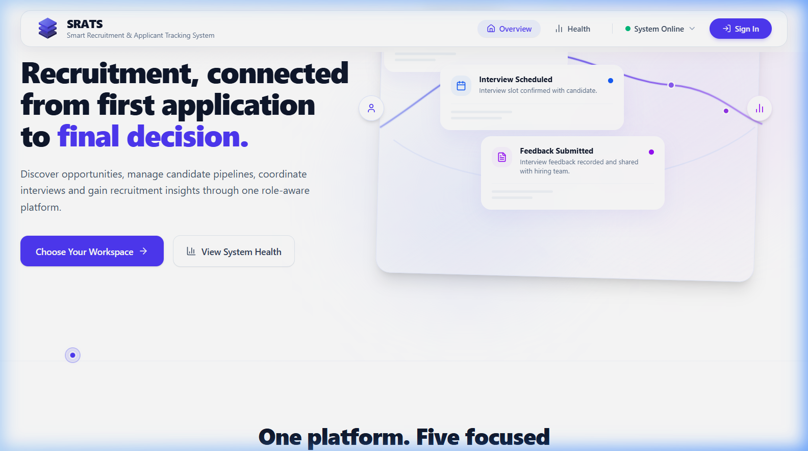
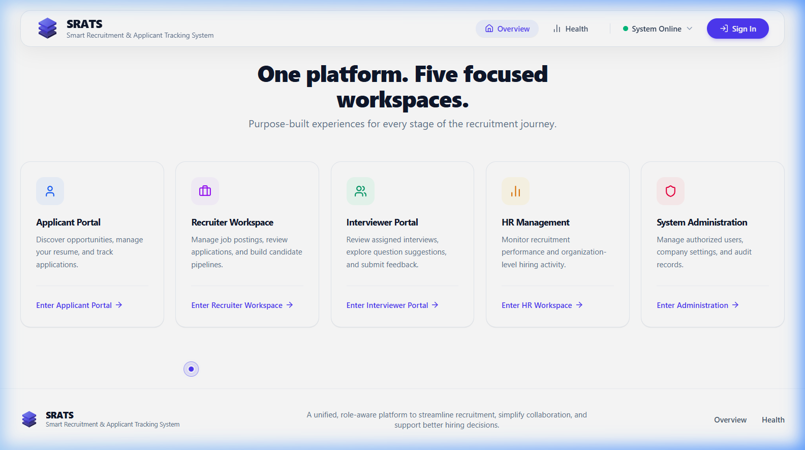

# SRATS — Smart Recruitment and Applicant Tracking System

> **Recruitment, connected from first application to final decision.**

SRATS is a full-stack recruitment and applicant tracking platform designed to connect applicants, recruiters, interviewers, HR managers, and system administrators through a unified, role-aware workspace.

The platform streamlines the entire recruitment lifecycle—from job publishing and application submission to candidate pipeline management, interview coordination, structured evaluation, and hiring decisions. It combines a relational data architecture, server-enforced authorization, auditable workflows, and Gemini-powered AI assistance while keeping recruitment records and business decisions under controlled application logic.

SRATS is built around one core principle: **AI assists people; verified application data and authorized human decisions govern recruitment.**

---

<p align="center">
  
</p>

---

## Table of Contents

- [Overview](#overview)
- [Key Features](#key-features)
- [Role-Based Workspaces](#role-based-workspaces)
- [AI Capabilities](#ai-capabilities)
- [Recruitment Workflow](#recruitment-workflow)
- [System Architecture](#system-architecture)
- [Technology Stack](#technology-stack)
- [Security and Data Integrity](#security-and-data-integrity)
- [Getting Started](#getting-started)
- [Environment Configuration](#environment-configuration)
- [Testing and Verification](#testing-and-verification)
- [Project Structure](#project-structure)
- [Design Principles](#design-principles)
- [Project Status](#project-status)
- [Future Improvements](#future-improvements)
- [Author](#author)
- [License](#license)

---

## Overview

Traditional recruitment processes often involve disconnected job listings, scattered candidate information, manual interview coordination, inconsistent evaluations, and limited visibility into hiring progress.

SRATS addresses these challenges through a centralized recruitment platform with dedicated workspaces, structured workflows, real-time persistence, and AI-assisted decision support.

### Project Objectives

- **Centralize recruitment activities** in one cohesive platform.
- **Provide secure, role-specific experiences** for all recruitment stakeholders.
- **Manage requisitions, applications, interviews, and feedback** through controlled, auditable workflows.
- **Enable applicants** to discover opportunities and track their application progress transparently.
- **Reduce repetitive cognitive work** through grounded, non-hallucinatory AI assistance.
- **Maintain data integrity, auditability, and organization-level access boundaries.**
- **Provide actionable recruitment insights** computed directly from persisted application data.

---

## Key Features

### 1. Role-Based Access and Authentication
SRATS provides five distinct workspace experiences backed by shared authentication infrastructure and server-side role-based access control.
- Role-specific authentication experiences with role context auto-selection.
- Applicant registration and profile management.
- Protected routes and authenticated API access.
- Access-token refresh and session-expiration handling.
- Role and account-status validation.
- Organization and company-level authorization.
- Restricted administrator onboarding.
- Frontend route guards improve navigation, while the backend remains the authoritative security boundary.

### 2. Applicant and Resume Management
- Manage applicant profiles and skills.
- Upload and replace resumes through validated workflows.
- Restrict resume retrieval to authorized users.
- Review application history and status transitions.
- Analyze resumes with AI after explicit applicant consent.
- Review extracted information before confirming changes.
- Preserve the distinction between extracted information and applicant-confirmed profile data.

### 3. Job Management and Discovery
- Create and manage job requisitions.
- Support draft, published, and closed job lifecycles.
- Validate required fields before publication.
- Discover published opportunities using search and filters.
- Support pagination, sorting, and job-detail views.
- Enforce job visibility rules strictly on the backend.
- Preserve normal job discovery independently of AI recommendations.

### 4. Application Tracking
- Submit applications to eligible, published opportunities.
- Prevent duplicate applications.
- Associate applications with the relevant applicant, job, and resume.
- Track application status and status history.
- Enforce valid transitions through backend business rules.
- Provide recruiters with a structured candidate pipeline.
- Maintain appropriate notifications and audit events.

### 5. Interview Management
- Schedule interviews with assigned interviewers.
- Support interview rescheduling and cancellation.
- Validate interviewer availability and overlapping commitments.
- Store timestamps in UTC while presenting appropriate local times.
- Provide interview-specific candidate access.
- Collect structured interviewer feedback.
- Maintain interview and application lifecycle consistency.

### 6. Notifications and Analytics
- Persist domain-event notifications.
- Display unread notification counts.
- Support individual and bulk notification updates.
- Provide role-specific dashboards.
- Calculate analytics from database records.
- Apply appropriate applicant, company, organization, and interviewer scopes.
- Display truthful empty, loading, and error states.

### 7. Administration and Auditability
- Manage authorized user and company records.
- Control account activation and deactivation.
- Manage permitted company and user associations.
- Inspect audit events through authorized administrative interfaces.
- Protect administrative operations through backend authorization.
- Apply safeguards around privileged accounts and sensitive data.

---

## Role-Based Workspaces

<p align="center">
  
</p>

| Role | Responsibilities |
| :--- | :--- |
| **Applicant** | Manage profiles and resumes, discover jobs, apply for opportunities, track applications, review interviews, and use AI assistance. |
| **Recruiter** | Manage requisitions, review applications, operate the candidate pipeline, coordinate interviews, and monitor recruitment activity. |
| **Interviewer** | Access assigned interviews, review permitted candidate information, use interview-question suggestions, and submit structured feedback. |
| **HR Manager** | Review authorized recruitment analytics, organizational hiring activity, and recruitment workflow performance. |
| **Administrator** | Manage authorized users and companies, oversee platform operations, and inspect audit records. |

> **Authorization Boundary**: Each role operates strictly within its own authorization boundaries. Access to an interface does not automatically grant access to the underlying records or operations.

---

## AI Capabilities

SRATS integrates Google's Gemini API through a dedicated server-side AI orchestration layer. AI capabilities are designed to assist users with recruitment tasks without replacing established business rules or human judgment.

### AI Resume Analysis
The resume-analysis workflow:
1. Requires explicit applicant consent.
2. Retrieves the applicant's resume through authorized private storage.
3. Processes the document through the server-side AI integration.
4. Validates the structured model response against schemas.
5. Presents extracted information for applicant review.
6. Allows the applicant to selectively confirm profile changes and skills.
7. Records relevant analysis and confirmation audit events.
*Extracted information is never silently written into the applicant's profile.*

### AI-Assisted Job Recommendations
The recommendation workflow uses available applicant information and real published-job records to identify potentially relevant opportunities:
- Recommendations are grounded strictly in existing job records.
- Explanations reflect actual skills, qualifications, and job requirements.
- Unconfirmed resume extractions are not silently treated as verified applicant facts.
- Recommendations are advisory, not eligibility decisions.
- Applicants retain full access to normal job-discovery tools.
- Recommendations never automatically submit applications or reject opportunities.

### AI Interview Question Intelligence
The interview-question engine helps authorized users prepare structured interviews using relevant requisition requirements and candidate signals:
- Job-related interview question suggestions and contextual follow-ups.
- Three-tier evaluation rubrics: *Poor*, *Acceptable*, and *Excellent*.
- Expected positive signals to guide structured assessment.
- Server-side authorization checks and audit logging.
- Generated rubrics serve as decision-support material and never automatically score or reject candidates.

### Role-Aware AI Assistant
The conversational assistant provides role-aware guidance using approved backend tools:
- Authorized, scoped access to real application data.
- Validated tool arguments and structured responses.
- Prompt-injection defenses and untrusted-document boundary framing.
- Restricted tool execution with sensitive data minimization.
- Honest handling of unavailable information and provider failures.
- Auditable AI interactions.

> **AI Security Principle**: Gemini is an intelligence layer, not the database, authorization authority, or autonomous hiring decision-maker.

---

## Recruitment Workflow

```
Recruiter Creates Job
        │
        ▼
Job Validation & Publication
        │
        ▼
Applicant Discovers Published Job
        │
        ▼
Application Submission
        │
        ▼
Recruiter Reviews Candidate
        │
        ▼
Application Pipeline Progression (Kanban)
        │
        ▼
Interview Scheduling & Assignment
        │
        ▼
Interviewer Evaluation & Feedback (Rubrics)
        │
        ▼
Recruitment Decision (Hire / Reject / Progress)
        │
        ▼
Updated Application State, Notifications & Audit Records
```

*Each transition is strictly subject to the platform's validation, authorization, and business-state rules.*

---

## System Architecture

### Layered Architecture

```
+---------------------------------------------------+
|                  React Frontend                   |
| Dashboards | Forms | Job Discovery | AI Assistant |
+---------------------------------------------------+
                          │
                          ▼
+---------------------------------------------------+
|                Versioned REST API                 |
|               Express + TypeScript                |
+---------------------------------------------------+
                          │
                          ▼
+---------------------------------------------------+
|          Authentication & Authorization           |
| Identity | Roles | Ownership | Tenant Boundaries  |
+---------------------------------------------------+
                          │
                          ▼
+---------------------------------------------------+
|               Application Services                |
|  Recruitment Rules | Validation | State Machines  |
+---------------------------------------------------+
                          │
                          ▼
+---------------------------------------------------+
|             Repositories & Database               |
|   Relational Persistence | Migrations | SQL-ACID  |
+---------------------------------------------------+
```

### AI Architecture

```
Authenticated Client
        │
        ▼
SRATS AI API (/api/v1/ai)
        │
        ▼
AI Orchestrator
  ├── Prompt & Input Sanitizer (Defense-in-Depth)
  ├── Structured Output Validation (Zod Schemas)
  └── Authorized Tool Registry
        │
        ▼
Approved SRATS Domain Services
        │
        ▼
Real Application Records (Database / Storage)
        │
        ▼
Validated & Grounded AI Response
```

The AI orchestration layer uses approved application services rather than direct database access. Tool execution remains subject to backend authentication, authorization, argument validation, and applicable business rules.

---

## Technology Stack

| Layer | Technology |
| :--- | :--- |
| **Frontend** | React 19 |
| **Frontend Tooling** | Vite 8 |
| **Styling** | Tailwind CSS v4 |
| **Language** | TypeScript |
| **Backend** | Node.js and Express |
| **API Architecture** | Versioned REST API (`/api/v1`) |
| **Database** | SQLite (development) / Relational SQL |
| **Database Access** | Repository and Service abstractions |
| **Schema Evolution** | SQL Migrations (`/migrations`) |
| **AI Integration** | Google Gemini API |
| **AI SDK** | `@google/genai` |
| **Runtime Validation** | Zod |
| **Authentication** | JWT-based Access and Refresh Tokens |
| **Testing** | Node.js Test Runner with `tsx` |
| **Type Checking** | TypeScript Compiler (`tsc --noEmit`) |

---

## Security and Data Integrity

Security is enforced across frontend, API, service, storage, and persistence layers.

### Authentication & Authorization
- Backend-enforced role permissions.
- Object-level authorization and IDOR protection.
- Company and organization scope enforcement.
- Interviewer-assignment restrictions.
- Protected administrative operations.
- Account-status validation.

### Data Protection
- Server-side AI credentials (never exposed to client).
- Private resume storage and authorized file retrieval.
- File-type and content validation.
- Parameterized database queries.
- Relational constraints and transaction handling.
- Sanitized error responses.
- Sensitive-data minimization in logs and AI requests.

### AI Safety
- Explicit consent for external AI processing.
- Structured model-output validation.
- Untrusted-document boundary framing.
- Prompt-injection defenses.
- Narrowly scoped tools and validated arguments.
- Human review of AI-extracted resume information.
- Advisory-only recommendations and interview assistance.
- Graceful handling of provider unavailability.

---

## Getting Started

### Prerequisites
- **Node.js** (v18+ recommended)
- **npm**
- **Git**
- A **Gemini API Key** (optional, for live Gemini processing)

### 1. Clone the Repository
```bash
git clone https://github.com/Soumik-12/SRATS_System.git
cd SRATS_System
```

### 2. Install Dependencies
```bash
npm install
```

### 3. Configure Environment Variables
Copy `.env.example` to `.env`:
```bash
# On Linux / macOS:
cp .env.example .env

# On Windows PowerShell:
Copy-Item .env.example .env
```
Populate the required values according to your local environment. *Never commit `.env` or any file containing real credentials.*

### 4. Start the Development Server
```bash
npm run dev
```
Open the local URL printed by the development server (default: `http://localhost:3000`).

### 5. Check Service Health
With the server running, visit:
```
http://localhost:3000/api/v1/health
```
Confirm that the response reports healthy application and database states.

### 6. Access the Application
Open `http://localhost:3000` to access the landing page, choose your workspace, or log in.

---

## Environment Configuration

| Category | Variable | Purpose |
| :--- | :--- | :--- |
| **Application** | `PORT` | Local server port (default: `3000`) |
| **Database** | `DATABASE_URL` | SQLite database file location |
| **Authentication** | `JWT_SECRET` | Secret for signing JWT access tokens |
| **Authentication** | `JWT_REFRESH_SECRET` | Secret for signing refresh tokens |
| **Gemini AI** | `GEMINI_API_KEY` | Server-side Google Gemini API key |
| **Gemini AI** | `GEMINI_MODEL` | Gemini model identifier (e.g., `gemini-2.5-flash`) |
| **Storage** | `STORAGE_DIR` | Private resume storage directory |
| **Admin Bootstrap** | `ADMIN_BOOTSTRAP_KEY` | Key for controlled initial administrator onboarding |

---

## Testing and Verification

Run the project's configured checks from the repository root:

### Automated Tests
```bash
npm test
```

### Type Checking
```bash
npm run lint
```

### Production Build
```bash
npm run build
```

### Verification Status
| Check | Reported Result |
| :--- | :--- |
| **Implementation Phases** | 18 Completed |
| **Automated Tests** | 253 passing |
| **Test Suites** | 16 suites |
| **Test Failures** | 0 |
| **TypeScript Check** | Passed (`tsc --noEmit`) |
| **Production Build** | Passed |
| **Local Development Server** | Healthy on port 3000 |

---

## Project Structure

```text
SRATS/
├── docs/
│   └── images/               # Documentation & preview screenshots
├── migrations/               # SQL schema migrations (V1 through V8)
├── server/
│   ├── ai/                   # Gemini client, tool registry, orchestrator
│   ├── config/               # Environment and configuration
│   ├── controllers/          # Express route controllers
│   ├── db/                   # Database connection, migrator, transactions
│   ├── domain/               # Core entities and validation schemas
│   ├── middleware/           # Auth, logging, error handling, correlation
│   ├── repositories/         # Relational database repositories
│   ├── routes/               # Modular Express API routes (/api/v1)
│   ├── security/             # JWT, crypto, authorization middleware
│   ├── services/             # Business logic & domain services
│   └── types/                # Backend TypeScript types
├── src/
│   ├── api/                  # Frontend API client
│   ├── auth/                 # AuthContext & ProtectedRoute
│   ├── components/           # UI components, modals, drawers, widgets
│   ├── pages/                # HomePage, AuthPage, HealthPage, Dashboards
│   ├── services/             # Frontend service layers
│   ├── types/                # Frontend TypeScript types
│   ├── index.css             # Tailwind CSS & custom styling
│   └── main.tsx              # Application entry point
├── tests/
│   └── backend/              # Automated backend test suites
├── .env.example              # Environment template
├── package.json              # Project dependencies & scripts
├── tsconfig.json             # TypeScript configuration
└── README.md                 # Project documentation
```

---

## Design Principles

- **Data integrity first**: Business records are persisted and validated through established application services.
- **Security by design**: Authorization, ownership, and tenant boundaries are enforced on the server.
- **AI with boundaries**: Model output is validated, grounded in permitted information, and prevented from bypassing application controls.
- **Human oversight**: Applicants confirm extracted resume information, and authorized people remain responsible for recruitment decisions.
- **Transparent behavior**: Missing data, invalid actions, and provider failures are communicated honestly rather than concealed with fabricated results.
- **Maintainability**: Layered services, repositories, migrations, contracts, and automated tests support controlled evolution.
- **Accessibility and usability**: Role-specific experiences remain understandable, responsive, and keyboard-accessible.

---

## Project Status

The project has completed its planned 18-phase implementation:
1. Core architecture and database foundation.
2. Authentication and role-based access control.
3. Applicant, resume, job, and application workflows.
4. Recruitment pipeline and interview management.
5. Notifications, dashboards, and administration.
6. Secure AI infrastructure and resume analysis.
7. AI-assisted job recommendations and interview-question intelligence.
8. Role-aware conversational assistance.
9. System integration and security auditing.
10. Frontend refinement, GSAP scramble animations, and accessibility improvements.
11. Final automated QA and release-readiness checks.

---

## Future Improvements

- Production deployment with persistent managed database infrastructure.
- Cloud object storage (S3 / GCS) and operational backup procedures.
- Expanded browser-based end-to-end and visual-regression tests.
- Production observability, OpenTelemetry, and operational alerting.
- Further accessibility and cross-browser verification.
- Performance optimization based on measured production usage.

---

## Author

**Soumik Prasad**  
B.Tech Computer Science and Engineering  
GitHub: [@Soumik-12](https://github.com/Soumik-12)  
Project: **SRATS — Smart Recruitment and Applicant Tracking System**

---

## License

This project is licensed under the [MIT License](LICENSE).

---

<p align="center">
  <b>SRATS</b> — <i>A connected recruitment experience built around real data, secure workflows, and responsible AI.</i>
</p>
